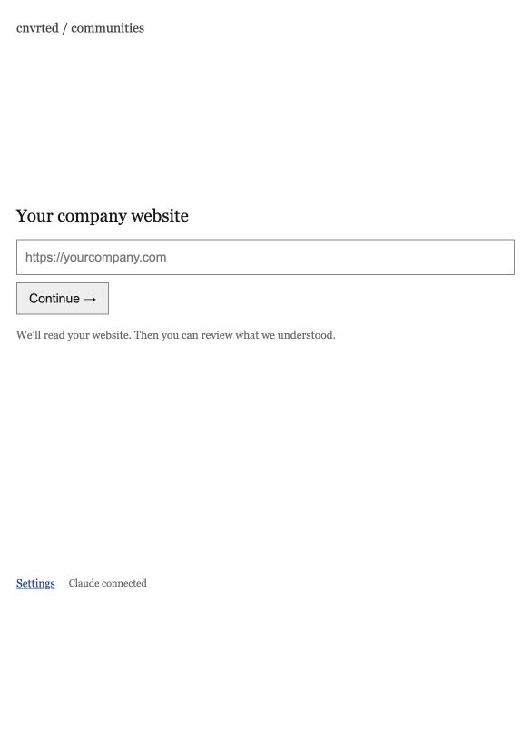

# cnvrted / communities

A deliberately plain website-to-community recommendation app.

1. **Website** — enter a company URL on a white page.
2. **Company brief** — review and edit the offer, buyers, roles, industries, company sizes, markets, problems, use cases and buying triggers.
3. **Communities** — browse ranked suggestions across Slack, Discord, Reddit, Facebook, LinkedIn, forums, WhatsApp, Telegram and other spaces. Each recommendation has a rank, fit score out of 100, a short reason, source and participation caveats.



## Run locally

Python 3.9 or newer; no Python packages or frontend build needed.

```sh
python3 app/server.py --port 8765
```

Open [localhost:8765](http://127.0.0.1:8765/). On macOS you can also double-click `start.command`.

Open **Settings**, choose Anthropic Claude, set `claude-sonnet-5-5`, enter your own API key, and save. Claude's native web search and fallback web fetch use the same key. Firecrawl and Exa are optional. Other supported AI providers need Firecrawl or Exa for live search. Usage is billed by your provider.

Environment variables are also supported:

```sh
export AI_PROVIDER=anthropic
export AI_MODEL=claude-sonnet-5-5
# Supply ANTHROPIC_API_KEY securely in your environment.
python3 app/server.py
```

The app does not automatically load `.env` files. Saved settings override environment values. See `.env.example` for variable names, never for real credentials.

By default, settings, jobs, company profiles, feedback and discoveries live in `app/data/`. Set `CNVRTED_DATA_DIR` to use another private local folder. Settings use owner-only file permissions; this is file protection, not encryption. API keys are not returned to the browser, exported, or committed.

## How it works

`analyze` jobs read the homepage and up to four relevant same-site product, pricing, use-case, customer or company pages. The AI produces a source-grounded brief, clearly separating observed facts, inferred buyers, and missing information. Exact evidence quotes are checked against retrieved text.

The browser presents the brief before any community search. Confirmed user corrections are authoritative for the target audience; buyer topics and discovery queries are reclassified when necessary. A saved analysis ID is used for the next step, so platform searches do not re-scrape the company.

`recommend` jobs search for communities, inspect up to three new pages, persist supported identities, refresh up to two older candidate sources, then retrieve and rank relevant catalog entries. Platform tabs perform real platform-specific discovery and ranking rather than filtering only the initial list. Up to 18 useful recommendations are shown per view; this is bounded research, not an exhaustive crawl of every community online.

The starting catalog is a public research snapshot of 1,186 candidates. Most are directory-derived; primary-source retrieval does not establish registration, current member activity, eligibility or permission to promote. Unknown pricing stays unknown. Both free and paid communities are eligible.

Duplicate matching uses observed URLs, or the same name plus the same branded host. Same-name conflicts with unconfirmed identity are saved for review and not counted as new. There is no dedicated editorial review queue UI yet.

Daily refresh is optional, runs only while this local process is alive, and reuses search results for 24 hours. Use **Search again** to bypass the cache. The app never joins communities or sends messages.

## Fit scores

The visible **fit /100** is an editorial relevance estimate, not a conversion probability. AI ranking considers the confirmed offer, buyer roles, pain points, goal, audience overlap, access constraints and evidence quality. Scores use anchors: 90–100 for a specific primary-evidence match, 70–89 for useful role overlap with unknowns, and 50–69 for conditional matches. Thin directory evidence alone should not receive a 90+ score.

A separate retrieval score combines buyer/practitioner topic match, TF-IDF text similarity, participation route, destination, evidence completeness, freshness and per-company feedback. It is available under **Evidence & joining details**. Without AI, visible scores use this simpler baseline and are labeled accordingly.

## A/B testing

The app independently assigns full/short company review and balanced/evidence-first recommendation ranking. Open **A/B results** in the footer for completion, clicks and Useful/Hide rates. Assignments and deduplicated events stay in the private local database. These are descriptive metrics; real users and a planned sample are needed before choosing a winner. See [the experiment plan](docs/ab-testing.md).

## Check

```sh
python3 -m unittest discover -s app -v
node --check app/static/app.js
```

Tests use temporary databases and mocked paid providers. They cover the two-stage flow, user corrections, platform-scoped ranking, bounded scores, source grounding, native search/fetch handling, identity conflicts, cache, restrictions, feedback, persistence and private-address rejection.

Live checks and screenshots are recorded in [docs/verification.md](docs/verification.md). An optional GitHub Actions template is included at [docs/checks.example.yml](docs/checks.example.yml); it is not installed automatically.

## Layout

- `app/server.py`: localhost API, job submission and static files.
- `app/engine.py`: company analysis, discovery, persistence and platform ranking.
- `app/intelligence.py`: prompts, profile corrections, retrieval and fit scoring.
- `app/webfetch.py`: bounded public fetches, Claude native search/fetch, Firecrawl and Exa.
- `app/storage.py`: SQLite and private local settings.
- `app/static/`: three-step UI and locally served platform logos.
- `communities.json`, `taxonomy.json`: portable public seed catalog.

This is a single-user local prototype. Public deployment requires authentication, per-user isolation, managed workers and suitable secret storage.
